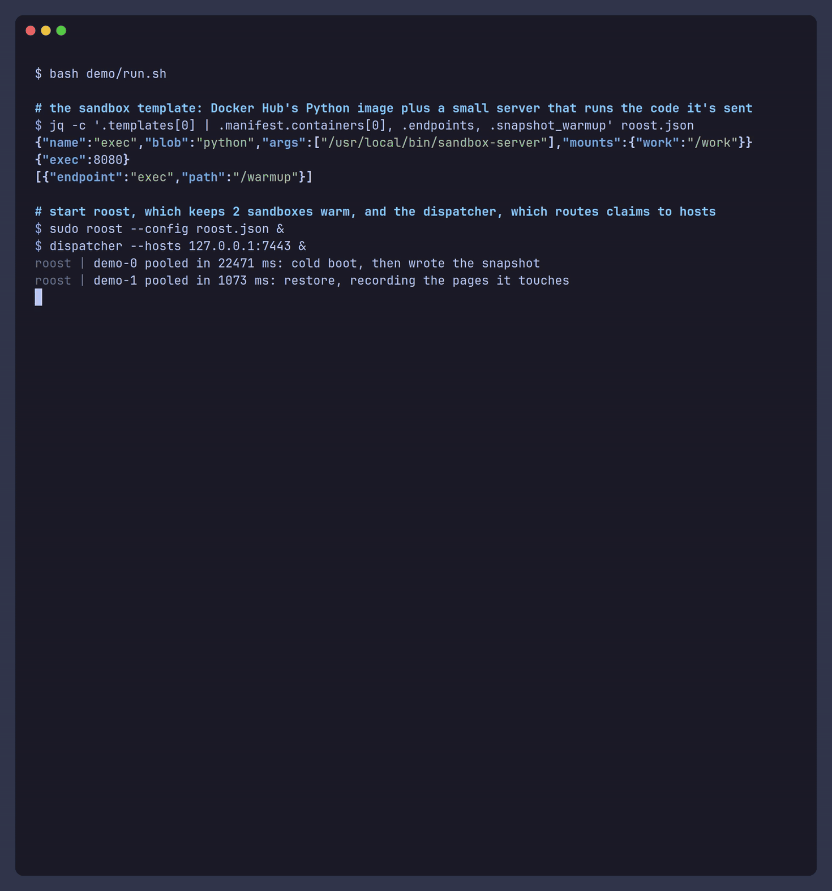
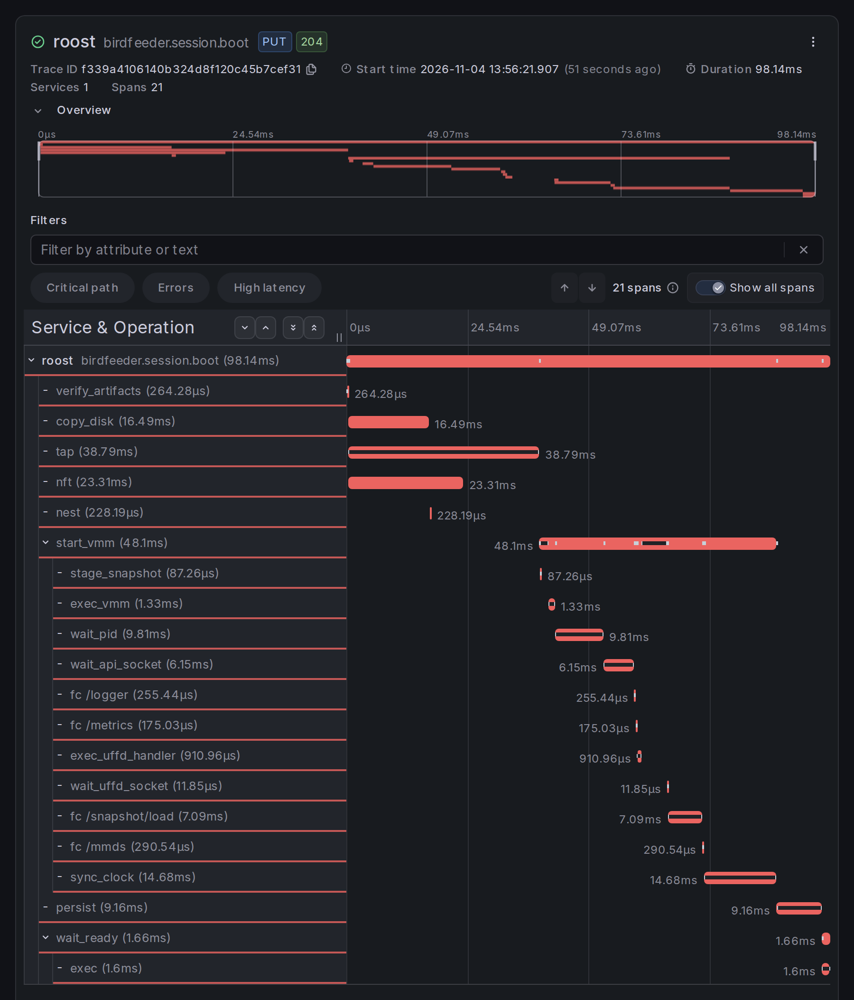

# birdfeeder

disposable Firecracker sandboxes for untrusted code. every claim gets a fresh VM restored from a snapshot in about 100 ms.



- snapshot restores: about 105 ms and 11 MiB per guest, vs 1.1 s and 73 MiB for a cold boot. it does this with a recorded working set and userfaultfd ([benchmarks](docs/benchmarks.md)). memory can live in S3 too
- isolation: every VM gets the jailer, its own cgroup, netns and private disk, plus rate limits
- default-deny egress: each claim lists the CIDRs and domains (`*.example.com`) it can reach. metadata, link-local, cross-guest and SMTP are always blocked
- OCI workloads: `birdfeeder convert` turns a registry image into a SquashFS blob that a template can run
- survives restarts: when roost comes back up, it adopts the VMs that are still running
- OpenTelemetry: boot spans, VM metrics and container logs, all sent over OTLP

## how it works




## example: agent sandboxes

convert an image (Linux, `squashfs-tools` 4.6+):

```sh
birdfeeder convert ghcr.io/you/python-sandbox:v1 /var/lib/birdfeeder/images/python-sandbox.squashfs -o name
```

describe the host and template in `roost.json` ([guest images](docs/guests.md)):

```json
{
  "firecracker_bin": "/usr/local/bin/firecracker",
  "kernel_image_path": "/var/lib/birdfeeder/artifacts/kernel",
  "kernel_sha256": "<sha256>",
  "max_sessions": 8,
  "max_vcpus": 8,
  "max_memory_mib": 4096,
  "templates": [
    {
      "template_id": "agent-sandbox-v1",
      "base_disk": "/var/lib/birdfeeder/artifacts/base.ext4",
      "base_disk_sha256": "<sha256>",
      "scratch_disk": "/var/lib/birdfeeder/artifacts/scratch.ext4",
      "scratch_disk_sha256": "<sha256>",
      "blobs": { "python": "/var/lib/birdfeeder/images/python-sandbox.squashfs" },
      "blob_sha256": { "python": "<sha256>" },
      "manifest": {
        "volumes": ["work"],
        "containers": [
          {
            "name": "exec",
            "blob": "python",
            "args": ["/usr/local/bin/sandbox-server", "--port", "8080", "--workdir", "/work"],
            "mounts": { "work": "/work" }
          }
        ],
        "readiness": [{ "name": "exec", "tcp_port": 8080 }]
      },
      "endpoints": { "exec": 8080 },
      "vcpus": 1,
      "mem_mib": 512,
      "pool_target": 4,
      "snapshot": "lazy",
      "snapshot_warmup": [{ "endpoint": "exec", "path": "/healthz" }]
    }
  ]
}
```

claim a sandbox that can reach PyPI and nothing else:

```sh
birdfeeder claim agent-sandbox-v1 --allow-fqdn pypi.org,files.pythonhosted.org --idle-timeout 15m
```

```
NAME      GENERATION  STATE    TEMPLATE          HOST    ENDPOINTS
host-a-3  7           claimed  agent-sandbox-v1  host-a  exec=10.0.0.5:31008
```

use it, then delete it:

```sh
curl --data-binary @task.py http://$(birdfeeder endpoint host-a-3)
birdfeeder rm host-a-3 --generation 7
```

the API is plain gRPC. retries and fencing are covered in [runtime contracts](docs/runtime.md#claims-and-retries).

## status

it runs end to end on Linux/KVM in the smoke suites. not implemented yet: release packaging, API authentication, and on-demand boot when a pool is empty.

## development

```sh
mise trust && mise install
mise run check
mise run test
mise run dev up
mise run test smoke
```

there's more in [deploying](docs/deploy.md), [guest images](docs/guests.md), [telemetry](docs/telemetry.md) and [benchmarks](docs/benchmarks.md).
