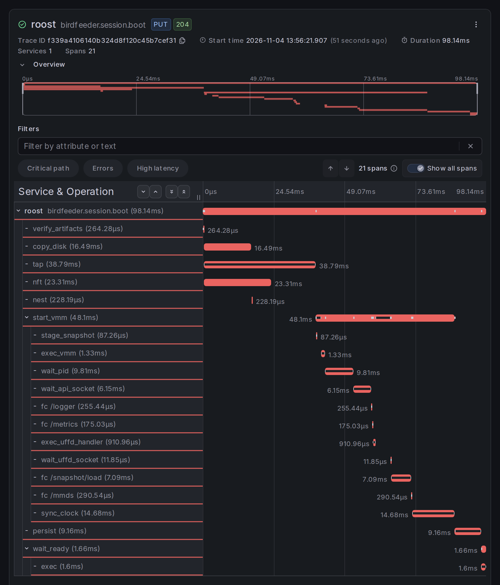

# benchmarks

`mise run test bench` claims and deletes one guest at a time from a one-guest pool of the HTTP example, for each boot mode. `BENCH_RUNS` sets how many claims per mode. it reports time to ready (the `birdfeeder.session.boot` span), the first HTTP request after the claim, and Firecracker's resident memory. raw samples end up in `bin/bench.json`.

## results

GitHub Codespace (2 vCPUs, nested KVM), Firecracker 1.17, 1 vCPU / 512 MiB guest, 20 claims per mode, 2026-11-04. nested virtualization on a shared host is noisy, so compare these to each other, not to real hardware. `_s3` modes read memory from a single-node SeaweedFS on the same host.

| mode | ready p50 | ready p90 | first request p50 | vmm RSS p50 |
|---|---|---|---|---|
| cold | 1.129s | 1.366s | 2.7ms | 73 MiB |
| eager | 509ms | 824ms | 6.2ms | 515 MiB |
| prefetch | 105ms | 110ms | 7.3ms | 11 MiB |
| eager_s3 | 547ms | 666ms | 6.5ms | 515 MiB |
| prefetch_s3 | 159ms | 172ms | 29.6ms | 64 MiB |

- prefetch loads the working set recorded on the first restore, then serves the rest of memory on fault. a guest only holds what it actually touches.
- eager restores copy all 512 MiB before the guest resumes.
- from S3, only non-zero pages get fetched. prefetch_s3 reads the packed working set in a few ranges, then fills in the rest of the non-zero memory in the background. that's why its RSS is higher by the first request. the first request is slower because it faults outside the recorded working set, and each of those faults is a round trip to the store.

## where the time goes

disk copy, network namespace and host nftables all run at the same time before the VMM starts. network setup goes over netlink. a third of it is the stale conntrack sweep, which walks every hash bucket no matter how many flows there are. a claim spends most of its time saving session state and applying nftables. keep `session_state_dir` off the guest disks' ext4 journal, or that fsync gets stuck behind guest writeback.
